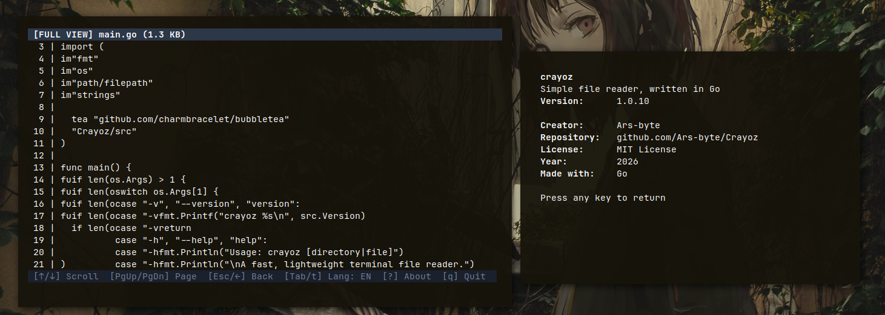

# Crayoz

[](https://go.dev/)
[](LICENSE)
[](https://github.com/Ars-byte/Crayoz/releases)

> **Idioma / Language**: **Español** | [English](README.md)

**Crayoz** es un explorador y visor de archivos rápido, ligero y para la terminal desarrollado en Go utilizando [Bubble Tea](https://github.com/charmbracelet/bubbletea) y [Lip Gloss](https://github.com/charmbracelet/lipgloss).

---

## Vista previa (Preview)



---

## Características

- **Explorador de doble panel**: Navega por carpetas con panel lateral de previsualización en tiempo real.
- **Insignias por tipo de archivo**: Reconocimiento automático y badges coloreados para `.go`, `.c`, `.cpp`, `.rs`, `.py`, `.js`, `.ts`, `.json`, `.md`, `.sh`, `.zip`, imágenes y binarios.
- **Lector a pantalla completa**: Modo de lectura sin distracciones con desplazamiento línea por línea y por página.
- **Previsualización de múltiples formatos**:
  - **Código fuente**: Vista numerada de líneas con cabecera de lenguaje para Go, C, C++, Rust, Python, JavaScript, TypeScript, Shell y más.
  - **Renderizado de Markdown**: Vista estilizada para archivos `.md` con realce de encabezados, citas, listas, bloques de código y líneas divisorias.
  - **Datos estructurados**: Formateo automático de JSON y tablas alineadas por columnas para CSV y TSV.
  - **Archivos comprimidos**: Inspección de contenido en archivos `.zip` y descompresión al vuelo de archivos `.gz` / `.gzip`.
  - **Archivos binarios**: Detección de tipo MIME, metadatos, permisos y volcado hexadecimal interactivo.
- **Cambio instantáneo de idioma**: Alterna entre inglés y español al instante dentro de la TUI pulsando `Tab` o `t`.
- **Pantalla Acerca de**: Vista limpia y sin bordes (`?` o `a`) que muestra versión, creador, repositorio, licencia, año y tecnologías; pulsa cualquier tecla para volver.
- **Arquitectura modular**: Código organizado con ejecutable en la raíz y módulos internos en `src/`.
- **Sin dependencias externas en tiempo de ejecución**: Binario único y autocontenido.
- **Compilación y Releases automáticas (CI/CD)**: Cada cambio compila un ejecutable `.bin` y genera un paquete `.tar.gz` publicado en GitHub Releases.

---

## Atajos de teclado

| Tecla | Acción |
| --- | --- |
| `↑` / `k` | Mover cursor hacia arriba / desplazarse arriba |
| `↓` / `j` | Mover cursor hacia abajo / desplazarse abajo |
| `Enter` / `→` / `l` | Abrir carpeta / ver archivo en pantalla completa |
| `←` / `h` / `Backspace` | Subir un nivel de directorio / salir de pantalla completa |
| `PgUp` / `b` | Desplazar una página hacia arriba |
| `PgDn` / `f` / `Espacio` | Desplazar una página hacia abajo |
| `v` | Alternar modo pantalla completa |
| `Tab` / `t` | **Cambiar idioma de la TUI (Inglés ↔ Español)** |
| `?` / `a` | **Ver pantalla Acerca de** |
| `Cualquier tecla` | **Volver desde la pantalla Acerca de** |
| `Esc` | Volver al explorador desde pantalla completa |
| `q` / `Ctrl+C` | Salir del programa |

---

## Instalación

### Binarios precompilados (GitHub Releases)

Descarga el binario listo para usar (`Crayoz.bin`) o el tarball comprimido (`Crayoz-linux-amd64.tar.gz`) desde la sección de [Releases](https://github.com/Ars-byte/Crayoz/releases):

```bash
# Download and make executable
curl -L -o Crayoz https://github.com/Ars-byte/Crayoz/releases/latest/download/Crayoz.bin
chmod +x Crayoz

# Move to your PATH (optional)
sudo mv Crayoz /usr/local/bin
```

O descomprime el tarball:

```bash
tar -xzf Crayoz-linux-amd64.tar.gz
chmod +x Crayoz.bin
./Crayoz.bin
```

### Compilar desde el código fuente

Requisitos: [Go](https://go.dev/dl/) 1.22 o superior.

```bash
# Clonar el repositorio
git clone https://github.com/Ars-byte/Crayoz.git Crayoz
cd Crayoz

# Descargar dependencias
go mod download

# Compilar binario
go build -ldflags="-s -w" -o Crayoz .

# Ejecutar
./Crayoz
```

---

## Uso

```bash
# Iniciar en el directorio actual
./Crayoz

# Iniciar en un directorio específico
./Crayoz ~/Documentos

# Iniciar abriendo un archivo concreto
./Crayoz ./hello.txt
```

---

## Releases Automáticas (CI/CD)

Este repositorio cuenta con un workflow de GitHub Actions (`.github/workflows/release.yml`) que automáticamente:
1. Se ejecuta con cada push a `main` o al crear etiquetas de versión (`v*`).
2. Compila un binario optimizado `.bin` para Linux.
3. Empaqueta el ejecutable, la documentación y la licencia en un archivo `.tar.gz`.
4. Genera sumas de verificación SHA256 (`checksums.txt`).
5. Publica todos los archivos en GitHub Releases.

---

## Licencia

Este proyecto está bajo la [Licencia MIT](LICENSE).
